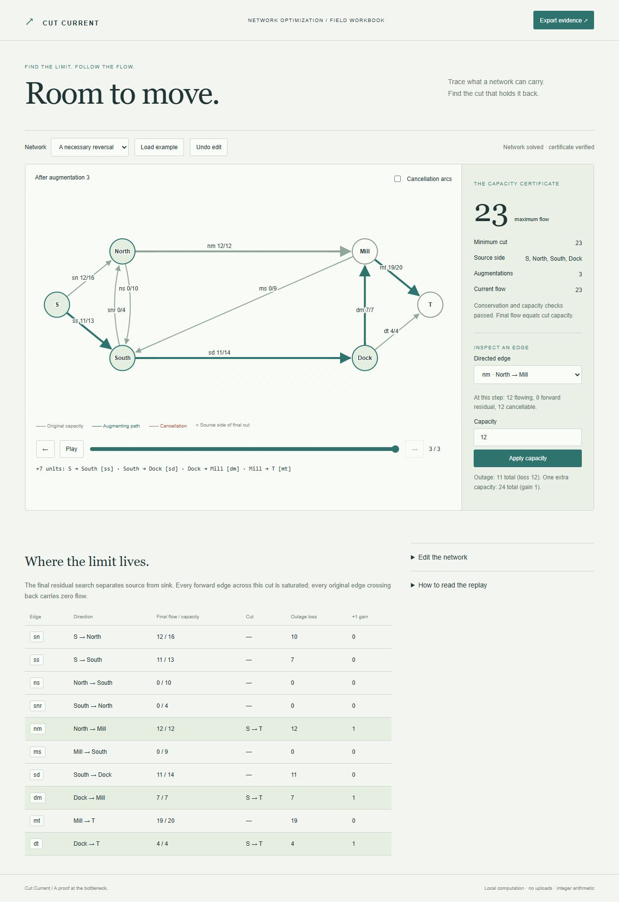
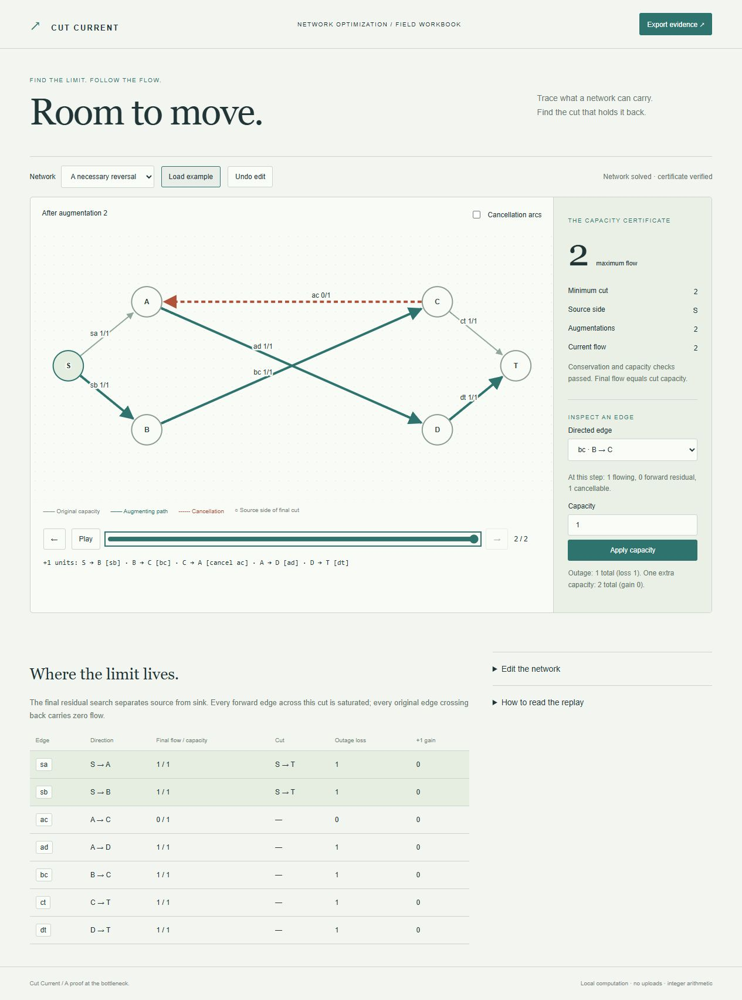

# Cut Current

An interactive directed-network flow workbook. Replay shortest augmenting paths, inspect cancellation arcs, change capacities, and verify the minimum cut that certifies the optimum.



## Run

Python 3.10+ serves the static files. Node 22+ runs development checks. No dependencies, build step, accounts, or external services.

```sh
python run.py --port 8000
```

Open http://127.0.0.1:8000. The Harbor example has maximum flow 23. Increasing edge `nm` from 12 to 13 raises it to 24; Undo restores the network. The second example requires cancelling the earlier `A → C` assignment to achieve flow 2.

## Features

- Edmonds–Karp breadth-first augmentation with a full flow snapshot after every step. Edge input order breaks shortest-path ties deterministically.
- Separate residual identities for parallel and opposite directed edges. Backward residual traversal cancels flow on its original edge; it does not consume an unrelated opposite edge.
- Capacity and node-conservation checks plus a final residual-reachability cut. Final flow equals cut capacity; the certificate includes per-node balances and crossing edge IDs.
- Per-edge outage and one-unit-upgrade sensitivity, each calculated by resolving the entire network. A saturated edge is not necessarily useful to upgrade.
- Keyboard-operable graph inspection, optional cancellation arcs, explicit playback, editable JSON, capacity editing, 30-step edit undo, portable studies, and complete JSON evidence.
- Empty/disconnected networks are valid and receive a zero-flow certificate. Invalid edits retain the last valid result.



## Model and limits

A study contains `nodes`, `source`, `sink`, and `edges: [{id, from, to, capacity}]`. Use 2–16 distinct ASCII node IDs and up to 64 uniquely named edges. No self loops. Capacities are integers from 0 to 1,000,000. Parallel and opposite edges are allowed; incoming source and outgoing sink edges are also valid. All arithmetic stays within JavaScript's exact integer range under these bounds. Input JSON is limited to 100 KB.

The source side shown by node shading always belongs to the **final** minimum-cut certificate. During replay, the highlighted path is the augmentation just applied, while flow labels and optional cancellation arcs describe its resulting state. Cut and sensitivity tables always describe the final solution. A backward highlighted arrow points in cancellation direction, with its original edge ID retained.

Node positions are illustrative. Dense networks can overlap visually; the edge selector and table remain available. This is a bounded single-commodity capacity model with no costs, travel times, lower bounds, or live network integration. Outage loss refers to one edge disabled in isolation; simultaneous failures require editing the network and solving again.

## Verification

```sh
npm test
npm run check
python -m unittest discover -s tests -v
```

Seven Node tests include 500 deterministic random multigraphs compared with independent exhaustive cut enumeration, every intermediate flow's feasibility, explicit reverse-arc cancellation, parallel/opposite edges, disconnected networks, and sensitivity re-solves. The Python HTTP test checks asset allowlisting, HEAD, and Host validation. CI runs Node 22/24 on Ubuntu and Node 24 on Windows.

Browser checks cover keyboard edge selection, capacity upgrade/undo, replay, empty and invalid networks, study import, and export. A separate Python verification enumerated every cut in the exported reversal example, checked all three flow snapshots and cancellation steps, and independently verified all 14 sensitivity results.

Fixtures: [Harbor](docs/example.json), [necessary reversal](docs/reversal.json). Background: [Princeton Algorithms — Maximum Flow](https://algs4.cs.princeton.edu/64maxflow/).
